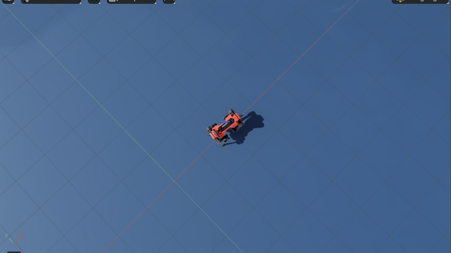
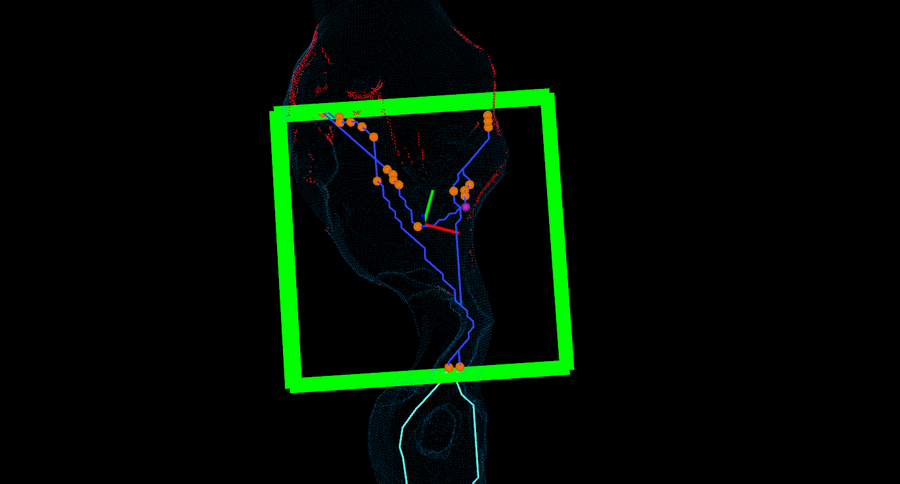

# Terra Incognita

**English** | [中文](README.zh-CN.md)

**A simulation platform for autonomous exploration of unknown underground environments with legged robots.** Built on Isaac Sim and ROS 2: one script installs everything, and two terminals run the full closed loop of localization and mapping, autonomous exploration and locomotion. It is meant to get a simulation set up quickly at the start of a research project, so that you can then swap one of the modules for your own algorithm.

<p align="center">
  
  
</p>

## Features

- **Scenes**: the DARPA SubT cave `simple_cave_01` (downloaded and converted automatically); other SubT worlds or procedurally generated confined terrain work too.
- **Robots**: ANYmal D (default) and Unitree Go2, driven by Isaac Lab's official pretrained rough-terrain walking policies, which take velocity commands.
- **Sensors**: simulated Ouster OS1-32 lidar (10 Hz, per-point timestamps and real motion distortion), 200 Hz IMU, ground-truth pose.
- **Algorithms**:
  - [BIEVR-LIO](https://github.com/ethz-asl/BIEVR-LIO): lidar-inertial localization and mapping;
  - [elevation_mapping_cupy](https://github.com/leggedrobotics/elevation_mapping_cupy): GPU elevation map;
  - CMU's [terrain analysis, local planner and path follower](https://github.com/HongbiaoZ/autonomous_exploration_development_environment);
  - [TARE](https://github.com/caochao39/tare_planner): exploration planner.
- **One Docker image** holds the whole environment (Isaac Sim 4.5, Isaac Lab 2.1.1, ROS 2 Humble, the algorithms' dependencies); all third-party sources are pinned, so the setup is reproducible.
- **Easy to swap**: any layer, such as localization or exploration planning, can be replaced by your own node (see [Plugging in your own algorithm](#plugging-in-your-own-algorithm)).

```
┌──────────────────────── Isaac Sim + Isaac Lab (sim.sh) ────────────────────────┐
│  physics ─ walking policy (velocity command -> joints) ─ lidar / IMU / truth   │
└──────┬───────────────────────────────────────────────────────────▲─────────────┘
       │ /lidar/points  /imu/data                                  │ /cmd_vel_stamped
┌──────▼───────────────────────── ROS 2 algorithms (explore.sh) ───┴─────────────┐
│ BIEVR-LIO ─► terrain analysis ─► TARE exploration ─► local planner ─► follower │
│           └─► elevation map                                                    │
└────────────────────────────────────────────────────────────────────────────────┘
```

## Requirements

| Item | Requirement | Tested with |
|---|---|---|
| OS | Linux x86_64 (Ubuntu 20.04 / 22.04) | Ubuntu 20.04 |
| GPU | NVIDIA RTX, ≥ 8 GB VRAM | RTX 4080 SUPER 16 GB |
| Driver | ≥ 535.129 (required by Isaac Sim 4.5) | 550 |
| RAM | 32 GB (the first Isaac Sim start compiles the render pipelines and peaks at ~21 GB; later ~5 GB) | 32 GB |
| Disk | ~70 GB free on the Docker partition | |
| Network | ~30 GB to download on the first installation | |

The lidar is simulated with ray casting, so Isaac Sim's RTX lidar (which needs driver 570 or newer) is not needed.

## Installation

### Step 0: prepare the host

You need the NVIDIA driver, Docker and the NVIDIA Container Toolkit. Skip what you already have; the first step of `setup.sh` checks them too.

```bash
nvidia-smi                                   # should show your GPU and a driver version >= 535

# Docker (official install script); let your user run docker without sudo (log in again afterwards)
curl -fsSL https://get.docker.com | sudo sh
sudo usermod -aG docker $USER

# NVIDIA Container Toolkit (see https://docs.nvidia.com/datacenter/cloud-native/container-toolkit/latest/install-guide.html)
curl -fsSL https://nvidia.github.io/libnvidia-container/gpgkey | sudo gpg --dearmor -o /usr/share/keyrings/nvidia-container-toolkit-keyring.gpg
curl -s -L https://nvidia.github.io/libnvidia-container/stable/deb/nvidia-container-toolkit.list | \
  sed 's#deb https://#deb [signed-by=/usr/share/keyrings/nvidia-container-toolkit-keyring.gpg] https://#g' | \
  sudo tee /etc/apt/sources.list.d/nvidia-container-toolkit.list
sudo apt-get update && sudo apt-get install -y nvidia-container-toolkit
sudo nvidia-ctk runtime configure --runtime=docker && sudo systemctl restart docker

docker run --rm --gpus all ubuntu nvidia-smi  # check: the GPU is visible inside a container
```

### Step 1: get the project

```bash
git clone https://github.com/ygd551/terra-incognita.git
cd terra-incognita
```

### Step 2: install everything

```bash
./setup.sh          # in mainland China: ./setup.sh --cn (Tsinghua apt mirrors for the image build)
```

`setup.sh` goes through the 7 steps below. **If it fails halfway (e.g. a network drop), just run it again**: finished steps are skipped.

| Step | What it does | First run (approx.) |
|---|---|---|
| 1 | Checks the driver, Docker, the NVIDIA Container Toolkit and the disk space | – |
| 2 | Fetches the third-party ROS 2 sources at pinned versions (BIEVR-LIO, elevation_mapping_cupy, TARE, CMU environment) and applies this project's patches | a few minutes |
| 3 | Clones and patches Isaac Lab v2.1.1, builds the Isaac Sim + Isaac Lab base image | 1–2 hours |
| 4 | Builds the project image `isaac_explore`: ROS 2 Humble and the algorithms' dependencies | ~40 minutes |
| 5 | Downloads the walking-policy checkpoints (published by Isaac Lab) and the SubT cave (~100 MB) | a few minutes |
| 6 | Converts the scene from Gazebo SDF to Isaac Sim USD | a few minutes |
| 7 | Builds the ROS 2 workspace | ~2 minutes |

It ends with `Installation complete` when everything is ready.

Step 6 is the first Isaac Sim start, which compiles the render pipelines with a memory peak of ~21 GB, only once. With 32 GB of RAM, close memory-hungry programs such as browsers during the installation. Everything runs in one container with a memory cap (by default total RAM minus 9 GB), so even if that is exceeded, only the processes in the container are killed and the desktop does not freeze.

- If you already have Isaac Lab v2.1.1: `ISAACLAB_DIR=/path/to/IsaacLab ./setup.sh` uses it instead of cloning another copy.
- If `docker pull` of the Isaac Sim image (15 GB) keeps failing, the script falls back to a resumable download (`tools/fetch_image.sh`).
- If Docker needs a proxy: set it for the Docker daemon (`/etc/systemd/system/docker.service.d/http-proxy.conf`) for pulls, and under `proxies` in `~/.docker/config.json` for builds.

**Updating**: `git pull && ./setup.sh` rebuilds images and recompiles as needed; unchanged steps take seconds.

## Running

Open two terminals, both in the project directory.

**Terminal 1: the simulation**

```bash
./sim.sh
```

The first start takes a few minutes (shader compilation, robot model download). The Isaac Sim window opens and ANYmal D stands at the cave entrance; wait until the terminal prints `[go2_sim] running` before going on.

**Terminal 2: the algorithms**

```bash
./explore.sh
```

RViz opens after a few seconds. Once the terminal shows `Exploration Started`, the robot explores on its own: it decides where to go, walks into the cave and avoids the rocks. When exploration is finished, it prints `Exploration completed, returning home` and walks back to the start.

**Stop**: run `./stop_all.sh` in any terminal.

### What you see

**Isaac Sim window**: the cave is closed, so the robot inside cannot be seen from outside. Start with `./sim.sh --see_through 0.25` to draw the cave semi-transparent, with the camera following the robot from above (picture above). Deeper in the cave there are more rock layers and the view gets darker; a smaller value (e.g. 0.1, smaller is more transparent) helps. This option only affects rendering, not physics or sensors. The exploration itself is easiest to follow in RViz.

**RViz window**, main symbols:

| Symbol | Meaning |
|---|---|
| Blue point cloud | Explored area (accumulated registered lidar points) |
| Short red and green lines | Robot pose: red is forward, green is left |
| Large green square | TARE's local planning horizon (30 m × 30 m); viewpoints are chosen only inside it |
| Small green squares | Subspaces still to explore, in visiting order (more solid = sooner). Exploration ends when they are all gone |
| Light cyan line / dark blue line | Global route / local route |
| Orange points | Selected viewpoints: places the robot will go to "take a look" |
| Red points | Surfaces not yet seen well and frontiers (boundary between known and unknown space) |
| Purple point | Current waypoint: ~5 m ahead, the target sent to the local planner |

**Exploration metrics**: every run writes `logs/metrics_<time>.txt`, whose 4 columns are **explored volume (m³), distance travelled (m), algorithm runtime, elapsed time (s)**; `trajectory_<time>.txt` next to it holds the robot's trajectory.

## Usage

### Options

| Command | Option | Effect |
|---|---|---|
| `./sim.sh` | `--robot go2` | Use the Unitree Go2 (default ANYmal D). `explore.sh` automatically uses the same robot |
| | `--headless` | No simulation window (saves GPU and RAM); watch in RViz only |
| | `--scene <USD file> --spawn X Y Z` | Another scene and spawn point (see [More scenes](#more-scenes)) |
| | `--see_through 0.25` | Semi-transparent scene, camera follows the robot |
| | `--auto_reset 10` | Stand the robot back up 10 s after a fall (for unattended runs with `lio:=gt`) |
| | `--help` | All options |
| `./explore.sh` | `lio:=gt` | Ground-truth localization instead of BIEVR-LIO, to test planning on its own |
| | `speed:=0.5` | Top speed, default 1.0 m/s (the limit the walking policies were trained for; do not go higher) |
| | `exploration:=false` | Everything except TARE: publish your own `/way_point` |
| | `planner:=false` | Localization and mapping only (no exploration, no local planner) |
| | `rviz:=false`, `elevation:=false` | No RViz, no elevation map |

### Common tasks

```bash
# The robot fell (the sim terminal prints "robot has fallen"): here = stand up in place, spawn = back to the start
docker exec isaac_explore bash -c 'source /opt/ros/humble/setup.bash && ros2 topic pub --once /sim/reset std_msgs/msg/String "{data: here}"'
#   the pose jumps, which BIEVR cannot follow; with BIEVR it is simpler to ./stop_all.sh and start again

# A shell in the container, for ros2 commands or the project's tools
./container.sh
source /isaac_explore/docker/algo_env.sh
ros2 topic list
python3 /isaac_explore/sim/watch_explore.py 600       # live position, distance travelled, waypoint
python3 /isaac_explore/sim/eval_lio.py                # walk a fixed route and measure BIEVR-LIO against ground truth
python3 /isaac_explore/sim/drive_test.py 0.5 0 0 10   # send a velocity command: vx vy wz seconds (stop explore.sh first)

# One unattended trial (headless sim + all algorithms + recording); results in logs/trial_<name>/
LAUNCH_ARGS="lio:=gt" ./run_trial.sh NAME [MAX_SIM_SECONDS] [sim.sh options...]
```

### Changing parameters

Restart the corresponding terminal after a change. Config and launch files are read straight from the project directory, so nothing needs to be rebuilt.

| What | Where | How it takes effect |
|---|---|---|
| Top speed | `./explore.sh speed:=0.5` | restart terminal 2 |
| Robot, scene, spawn point | `./sim.sh --robot / --scene / --spawn` | restart both terminals |
| Lidar mount, footprint, obstacle height threshold, viewpoint height, spawn height | `config/robots.yaml` | restart both terminals. The lidar mount must also be changed in `calibration` of `config/bievr_sim_<robot>.yaml` |
| BIEVR-LIO | `config/bievr_params.yaml`, `config/bievr_sim_<robot>.yaml` | restart terminal 2 |
| TARE exploration | `config/tare_go2.yaml` (shared by both robots) | restart terminal 2 |
| Terrain analysis, local planner, path follower (turn rate, acceleration, ...) | `launch/cmu/*.launch` | restart terminal 2 |
| Elevation map | `config/elevation_sim.yaml` | restart terminal 2 |
| Simulator-side speed limits, slowing down in turns, stuck recovery | constants at the top of `sim/go2_sim.py` | restart terminal 1 |
| Source code of a third-party package | `ros2_ws/src/<package>/` | `./container.sh build`, then restart terminal 2. To keep a change, turn it into a patch in `ros2_ws/patches/` and register it in `ros2_ws/fetch_src.sh` |
| Container memory cap (default: total RAM minus 9 GB, between 16 and 26 GB) | `ISAAC_EXPLORE_MEM=24g ./container.sh rm`, then start as usual | recreates the container |

### More scenes

**Other SubT worlds** (names in [osrf/subt](https://github.com/osrf/subt/tree/master/subt_ign/worlds); not all tested, the spawn point may need `--spawn`):

```bash
python3 tools/fetch_assets.py simple_tunnel_01            # download the world and the models it uses
docker exec isaac_explore /isaac-sim/python.sh /workspace/isaac_explore/sim/sdf_to_usd.py \
  /workspace/isaac_explore/assets/subt/worlds/simple_tunnel_01.sdf
./sim.sh --scene /workspace/isaac_explore/sim/scenes/simple_tunnel_01.usd
```

SubT artifacts (backpacks, survivor mannequins, phones, ...) are left out of the scene by default; see `sim/sdf_to_usd.py --skip`.

**Procedurally generated confined terrain** ([leggedrobotics/terrain-generator](https://github.com/leggedrobotics/terrain-generator)): walls, steps, platforms and overhangs assembled into 40 m × 40 m maps, good for narrow, multi-level collapsed spaces. Needs a Python on the host with torch and open3d:

```bash
PY=/path/to/python terrain_gen/setup.sh        # first time: pinned sources, patch, virtual environment
terrain_gen/.venv/bin/python terrain_gen/generate.py --cfg indoor --enable_sdf --mesh_dir $PWD/terrain_gen/out/indoor
#   --cfg: indoor | overhanging | overhanging_floor; 10 maps per run, ~5 minutes
rm -f terrain_gen/out/*/*/{sdf,mesh_terrain_sdf,mesh_terrain_distance}.npy   # distance fields the sim does not use, ~470 MB per map
docker exec isaac_explore bash -c 'cd /workspace/isaac_explore && /isaac-sim/python.sh sim/mesh_to_usd.py \
  terrain_gen/out/indoor/mesh_5/mesh.obj sim/scenes/tg_indoor_5.usd --spawn terrain_gen/out/indoor/mesh_5/spawnable_locations.npy'
#   the last line suggests --spawn X Y Z (for the Go2's standing height; add ~0.23 m to Z for ANYmal D)
./sim.sh --scene /workspace/isaac_explore/sim/scenes/tg_indoor_5.usd --spawn X Y Z
```

## Plugging in your own algorithm

All modules talk over ROS 2 topics (`use_sim_time`, with the `/clock` published by the simulation). To replace a layer, switch it off and let your node subscribe to the topics upstream of it and publish the ones downstream:

| Module to replace | How to switch it off | Your node subscribes to | Your node publishes |
|---|---|---|---|
| Exploration planner (TARE) | `./explore.sh exploration:=false` | `/state_estimation`, `/registered_scan`, `/terrain_map`, `/terrain_map_ext` | `/way_point` (`geometry_msgs/PointStamped`, frame `map`, a goal a few metres ahead) |
| Local planner and control | `./explore.sh planner:=false` | as above, plus your own goal | `/cmd_vel_stamped` (`geometry_msgs/TwistStamped`, body-frame `linear.x`, `linear.y`, `angular.z`) |
| Localization and mapping (BIEVR-LIO) | remove the `bievr_lio` node from `launch/explore.launch.py` | `/lidar/points`, `/imu/data` | `/bievr_lio/odom` (`nav_msgs/Odometry`, frame `odom`, child `imu`), `/bievr_lio/points/registered` (point cloud in frame `odom`) and TF `odom → imu` |
| Simulation only | do not run `explore.sh` | `/lidar/points`, `/imu/data`, `/ground_truth/odom`, `/clock` | `/cmd_vel` or `/cmd_vel_stamped` |

Main topics:

| Topic | Type | Notes |
|---|---|---|
| `/lidar/points` | PointCloud2 | 10 Hz, frame `lidar`; fields `x y z intensity t`, `t` = nanoseconds since the start of the sweep (for deskewing), `intensity` always 0 |
| `/imu/data` | Imu | 200 Hz, frame `imu` (= body) |
| `/ground_truth/odom` | Odometry | 50 Hz ground truth, frame `world` |
| `/state_estimation`, `/registered_scan` | Odometry, PointCloud2 | localization result and registered point cloud, frame `map`; input of the planning modules |
| `/terrain_map`, `/terrain_map_ext` | PointCloud2 | terrain analysis, `intensity` = height of the point above the ground; ~10 m near / ~40 m far |
| `/way_point` | PointStamped | goal from the exploration planner to the local planner |
| `/cmd_vel_stamped` | TwistStamped | velocity command; the sim clamps it to ±1 m/s forward / sideways and ±0.6 rad/s yaw |
| `/sim/reset` | String | `here` stands the robot up in place, `spawn` puts it back at the start |

## Project layout

```
├── setup.sh               one-shot installation
├── sim.sh / explore.sh    terminal 1: simulation; terminal 2: algorithms
├── stop_all.sh            stops the simulation and all algorithm nodes
├── run_trial.sh           one unattended trial
├── container.sh           the project container isaac_explore: shell, build, rm
├── docker/                project Dockerfile, Isaac Lab patch, environment of the algorithm processes, Python wheel list
├── tools/                 download checkpoints and scenes; resumable download of the Isaac Sim image
├── config/                per-robot parameters (robots.yaml), BIEVR-LIO, TARE and elevation map configuration
├── launch/                launch file of the whole stack (explore.launch.py), CMU module launch files (cmu/)
├── sim/                   simulator go2_sim.py, scene conversion, ground-truth localization, evaluation / recording / diagnostic tools
├── ros2_ws/               third-party sources and pinned versions (src.repos), fetch script, patches
├── terrain_gen/           procedural terrain generation
├── assets/  third_party/  (downloaded by setup.sh) checkpoints and scenes; Isaac Lab sources
└── logs/                  (written at run time) exploration metrics, trajectories, trial records
```

## Troubleshooting

| Problem | What to do |
|---|---|
| Downloads are slow or break off during installation | Run `./setup.sh` again; it carries on. In mainland China add `--cn` and see the proxy notes above |
| Compiling C++ during installation runs out of memory / freezes the desktop | 4 files are compiled at a time by default (~1.5 GB each). With less RAM: `ISAAC_EXPLORE_JOBS=2 ./setup.sh` |
| Step 6 (scene conversion) fails with exit code 137 | Killed for lack of memory: close other programs and run `./setup.sh` again; the render pipelines compiled so far stay cached |
| The simulation window or RViz does not open | Run `./sim.sh` again: it re-authorizes the container on the display (lost after an X restart or a new login). On a machine without a display: `./sim.sh --headless` and `./explore.sh rviz:=false` |
| `explore.sh` warns "no simulation running" | Start `./sim.sh` in terminal 1 first and wait for `[go2_sim] running` |
| Localization goes badly wrong, the trajectory jumps | Are two simulations running? Their topics get mixed up. `./stop_all.sh` and start again |
| The robot falls | See [Common tasks](#common-tasks). The walking policy is the official pretrained one, not trained for rubble and side slopes, and falls now and then |
| Not enough memory, sluggish desktop | `./sim.sh --headless`, `./explore.sh elevation:=false` |
| Uninstall | `docker rm -f isaac_explore && docker rmi isaac_explore isaac-lab-base nvcr.io/nvidia/isaac-sim:4.5.0`, `docker volume ls -q \| grep isaac_explore_ \| xargs docker volume rm`, then delete the project directory |

## Known limitations

These are limits of the current algorithms, and also what makes the platform useful for research:

- **TARE is not good at winding, branching caves.** It aims to "see every visible surface well", so branches behind bends and narrow gaps tend to be given up, and in `simple_cave_01` it declares exploration complete early. At narrow places such as tunnel entrances it sometimes puts the waypoint where the robot cannot get to, and the robot turns back and forth nearby. Exploration strategies better suited to such places (e.g. topology-based ones) can be plugged in with `exploration:=false`.
- **The walking policy is the official, general-purpose pretrained one**, not trained for rubble and side slopes; it falls now and then while exploring (see [Common tasks](#common-tasks)), and its top speed is 1.0 m/s. If it does not stand still after spawning, `sim.sh` puts it back and prints `[go2_sim] running` only once it stands.
- **BIEVR-LIO sometimes ends up with a constant offset of a few metres after initialization**, and tracks steadily from then on. Planning happens in its own frame, so exploration is not affected; keep it in mind when comparing localization accuracy.
- **The simulation runs at about 0.4× real time.** All nodes use simulation time, so results are unaffected; it just looks slow.
- **The lidar is simulated with ray casting**: no intensity, static scenes only.

## License

The code, configuration and documentation in this repository are licensed under [BSD-3-Clause](LICENSE).

This repository contains only this project's own content. Third-party sources, models and checkpoints are downloaded from their original locations by `setup.sh` and keep their own licenses:

| Component | Used for | License |
|---|---|---|
| [Isaac Sim 4.5](https://developer.nvidia.com/isaac/sim) (NVIDIA) | physics, rendering | NVIDIA Isaac Sim license (accepted by starting the container, `ACCEPT_EULA=Y`) |
| [Isaac Lab v2.1.1](https://github.com/isaac-sim/IsaacLab) | robot environments, walking policies (official pretrained checkpoints) | BSD-3-Clause |
| [BIEVR-LIO](https://github.com/ethz-asl/BIEVR-LIO) (ETH Zurich ASL) | lidar-inertial localization and mapping | BSD-3-Clause |
| [elevation_mapping_cupy](https://github.com/leggedrobotics/elevation_mapping_cupy) (ETH Zurich RSL), [ros2_numpy](https://github.com/Box-Robotics/ros2_numpy) | elevation map | MIT |
| [TARE](https://github.com/caochao39/tare_planner), [autonomous_exploration_development_environment](https://github.com/HongbiaoZ/autonomous_exploration_development_environment) (CMU) | exploration planner; terrain analysis, local planner | BSD |
| [terrain-generator](https://github.com/leggedrobotics/terrain-generator) (ETH Zurich RSL) | procedural terrain | MIT |
| [DARPA SubT worlds](https://github.com/osrf/subt) and [Fuel models](https://app.gazebosim.org/OpenRobotics) (Open Robotics) | cave scene | worlds Apache-2.0; models CC-BY-4.0 / CC0 (see each model's metadata) |

**Files in this repository adapted from third-party projects** (they keep the original license; each names its source at the top):

| File | Source | License |
|---|---|---|
| `launch/cmu/*.launch` | launch files of autonomous_exploration_development_environment, parameters changed | BSD |
| `config/tare_go2.yaml` | tare_planner's `config/tunnel.yaml`, parameters changed | BSD |
| `config/bievr_params.yaml` | BIEVR-LIO's `config/params.yaml`, two parameters changed | BSD-3-Clause |
| `ros2_ws/patches/*.patch` | small changes to the sources of tare_planner and autonomous_exploration_development_environment | BSD |
| `docker/isaaclab.patch` | changes to Isaac Lab's Docker configuration | BSD-3-Clause |
| `terrain_gen/patches/*.patch` | changes to terrain-generator | MIT |

All other code, scripts and documentation were written for this project and use the components above only through their APIs.

**Citation**: this project integrates the open-source work above into a ready-to-run simulation environment. If it helps your research, please cite the original papers of the components (see each project's page for how to cite it).

**Note**: the image that `setup.sh` builds locally contains Isaac Sim, which NVIDIA's license does not allow to be redistributed; do not push it to a public registry.
