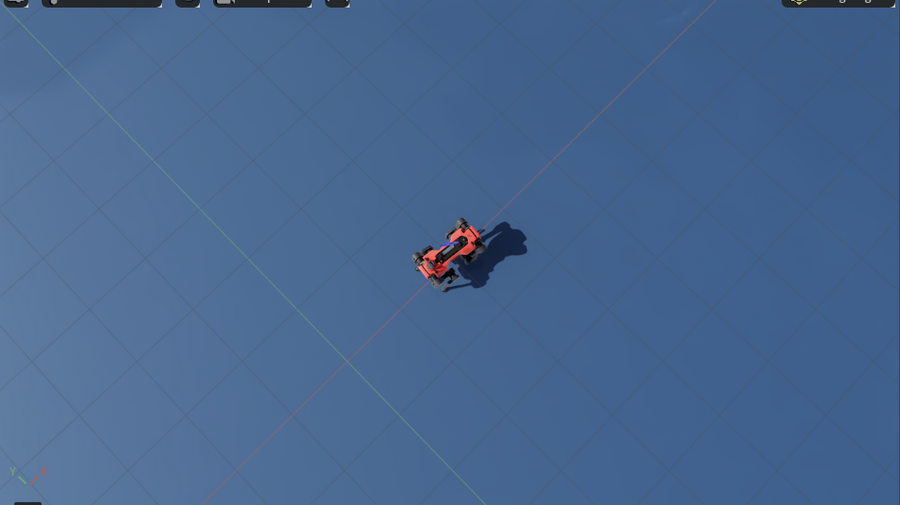
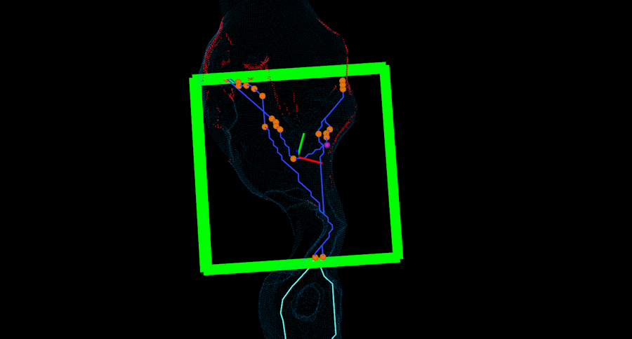
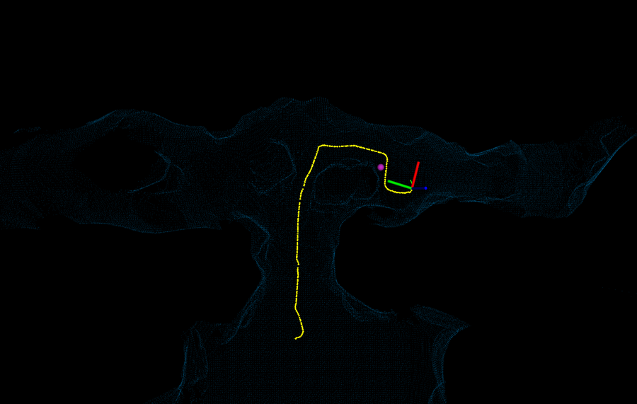
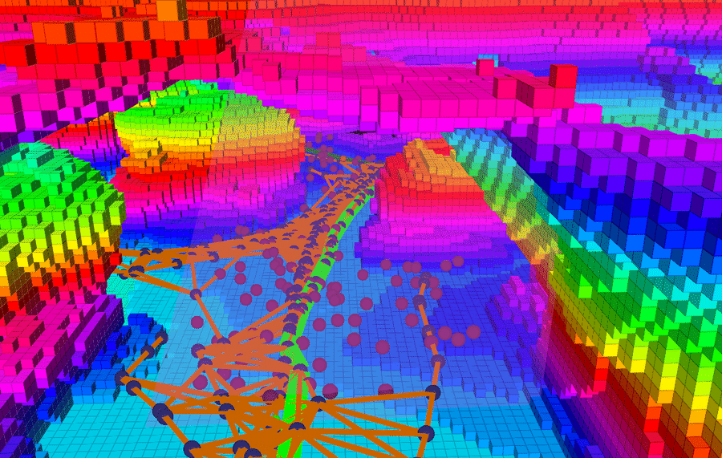

# Terra Incognita

[English](README.md) | **中文**

**四足机器人和无人机在未知地下环境中自主探索的仿真平台。** 基于 Isaac Sim 和 ROS 2，一个脚本装好全部环境，两个终端就能跑起"定位建图 + 自主探索 + 运动控制（行走或飞行）"的完整闭环。适合在研究的前期快速搭好仿真场景，再把其中某个模块换成自己的算法。

<p align="center">
  
  
  <br><sub>TARE 在 SubT 洞穴 <code>simple_cave_01</code> 中探索：Isaac Sim（左）和 RViz（右）</sub>
</p>
<p align="center">
  
  
  <br><sub>GBPlanner2 在 <code>simple_cave_02</code> 中探索：RViz（左），GBPlanner2 自带的 RViz，显示体素地图和规划图（右）</sub>
</p>

## 功能

- **场景**：DARPA SubT 的洞穴 `simple_cave_01`（`setup.sh` 自动安装）；另有 33 个场景一条命令即可添加：其他 SubT 洞穴、矿道、NIOSH 真实矿井复刻、决赛和城市场地、真实矿洞扫描，以及程序化生成的受限地形（见[更多场景](#更多场景)）。
- **机器人**：ANYmal D（默认）和 Unitree Go2，使用 Isaac Lab 官方预训练的复杂地形行走策略，接收速度指令；RMF-Obelix 无人机，飞行按物理过程仿真（旋翼推力、电机延迟、旋翼阻力、RotorS 的 Lee 几何控制器），同样接收速度指令（见[无人机](#无人机rmf-obelix实验性)）。
- **传感器**：模拟激光雷达（10 Hz，带逐点时间戳和真实的运动畸变）：机械旋转式，默认 Ouster OS1-32，也可以用 `--lidar` 换成其他型号（Ouster OS1-64、OS1-128、OS0-64、OS0-128，Velodyne VLP-16、HDL-32E，禾赛 PandarXT-32）；或者朝前看、非重复扫描的 Livox Avia（`--lidar avia`；无人机按机器人名字选 Ouster OS0-64 或 Livox Avia）；200 Hz IMU；真值位姿；无人机另有前置彩色相机和 LED 灯，场景和真实地下环境一样是黑暗的。
- **算法**：
  - [BIEVR-LIO](https://github.com/ethz-asl/BIEVR-LIO)：激光惯性定位建图；
  - [elevation_mapping_cupy](https://github.com/leggedrobotics/elevation_mapping_cupy)：GPU 高程图；
  - CMU 的[地形分析、局部规划、路径跟踪](https://github.com/HongbiaoZ/autonomous_exploration_development_environment)；
  - [TARE](https://github.com/caochao39/tare_planner)：自主探索规划；
  - 可选：用 [GBPlanner2](https://github.com/ntnu-arl/gbplanner_ros/tree/gbplanner2) 代替 TARE，作为对比探索策略的基线（见 [GBPlanner2](#gbplanner2可选实验性)）；无人机也用它探索。
- **行走评测与微调**（ANYmal D）：用分级的坡道、台阶、箱体和崎岖地面测出行走策略的能力边界，并可在更陡的地形上微调官方策略（见[行走评测与微调](#行走评测与微调)）。
- **一个 Docker 镜像**包含全部环境（Isaac Sim 4.5、Isaac Lab 2.1.1、ROS 2 Humble、各算法的依赖），第三方源码都锁定了版本，可以复现。
- **方便替换**：定位、探索规划等任何一层都可以换成你自己的节点（见[接入自己的算法](#接入自己的算法)）。

```
┌──────────────────────── Isaac Sim + Isaac Lab（sim.sh）────────────────────────┐
│  物理仿真 ─ 行走策略 / 飞控（速度指令）─ 模拟激光雷达 / IMU / 真值             │
└──────┬───────────────────────────────────────────────────────────▲─────────────┘
       │ /lidar/points  /imu/data                                  │ /cmd_vel_stamped
┌──────▼───────────────────────── ROS 2 算法（explore.sh）─────────┴─────────────┐
│  BIEVR-LIO 定位建图 ─► 地形分析 ─► TARE 探索规划 ─► 局部规划 ─► 路径跟踪       │
│                    └─► 高程图                                                  │
└────────────────────────────────────────────────────────────────────────────────┘
```

## 系统要求

| 项目 | 要求 | 测试环境 |
|---|---|---|
| 系统 | Linux x86_64（Ubuntu 20.04 / 22.04） | Ubuntu 20.04 |
| 显卡 | NVIDIA RTX，显存 ≥ 8 GB | RTX 4080 SUPER 16 GB |
| 驱动 | ≥ 535.129（Isaac Sim 4.5 的要求） | 550 |
| 内存 | 32 GB（第一次启动 Isaac Sim 时编译渲染管线，峰值约 21 GB，之后约 5 GB） | 32 GB |
| 磁盘 | Docker 所在分区约 70 GB 可用空间 | |
| 网络 | 首次安装约下载 30 GB | |

激光雷达是用射线投射模拟的，不需要 Isaac Sim 的 RTX 雷达（那需要 570 以上的驱动）。

## 安装

### 第 0 步：准备主机环境

需要 NVIDIA 驱动、Docker、NVIDIA Container Toolkit。已经装好的可以跳过，`setup.sh` 第一步也会检查。

```bash
nvidia-smi                                   # 能看到显卡和驱动版本（>= 535）即可

# Docker（官方安装脚本），并允许当前用户直接使用 docker（之后要重新登录）
curl -fsSL https://get.docker.com | sudo sh
sudo usermod -aG docker $USER

# NVIDIA Container Toolkit（详见 https://docs.nvidia.com/datacenter/cloud-native/container-toolkit/latest/install-guide.html）
curl -fsSL https://nvidia.github.io/libnvidia-container/gpgkey | sudo gpg --dearmor -o /usr/share/keyrings/nvidia-container-toolkit-keyring.gpg
curl -s -L https://nvidia.github.io/libnvidia-container/stable/deb/nvidia-container-toolkit.list | \
  sed 's#deb https://#deb [signed-by=/usr/share/keyrings/nvidia-container-toolkit-keyring.gpg] https://#g' | \
  sudo tee /etc/apt/sources.list.d/nvidia-container-toolkit.list
sudo apt-get update && sudo apt-get install -y nvidia-container-toolkit
sudo nvidia-ctk runtime configure --runtime=docker && sudo systemctl restart docker

docker run --rm --gpus all ubuntu nvidia-smi  # 验证：容器里能看到显卡
```

### 第 1 步：下载项目

```bash
git clone https://github.com/ygd551/terra-incognita.git
cd terra-incognita
```

### 第 2 步：一键安装

```bash
./setup.sh          # 在中国大陆建议用 ./setup.sh --cn（构建镜像时使用清华的 apt 镜像源）
```

`setup.sh` 依次完成下面 7 步。**中途失败（比如断网）直接重新运行即可**，已经完成的步骤会跳过：

| 步骤 | 内容 | 首次耗时（参考） |
|---|---|---|
| 1 | 检查驱动、Docker、NVIDIA Container Toolkit、磁盘空间 | – |
| 2 | 按固定版本拉取第三方 ROS 2 源码（BIEVR-LIO、elevation_mapping_cupy、TARE、CMU 环境），打上本项目的补丁 | 几分钟 |
| 3 | 克隆 Isaac Lab v2.1.1 并打补丁，构建 Isaac Sim + Isaac Lab 基础镜像 | 1–2 小时 |
| 4 | 构建项目镜像 `isaac_explore`：ROS 2 Humble 和各算法的依赖 | 约 40 分钟 |
| 5 | 下载行走策略权重（Isaac Lab 官方发布）和 SubT 洞穴场景（约 100 MB） | 几分钟 |
| 6 | 把场景从 Gazebo 的 SDF 格式转换成 Isaac Sim 的 USD 格式 | 几分钟 |
| 7 | 编译 ROS 2 工作区 | 约 2 分钟 |

最后打印 `Installation complete` 就说明全部就绪。

第 6 步是第一次启动 Isaac Sim，要编译渲染管线，内存峰值约 21 GB，只发生这一次。内存是 32 GB 的话，安装时建议关掉浏览器等占内存的程序。所有进程都运行在一个有内存上限的容器里（默认是总内存减 9 GB），即使超出，也只会终止容器里的进程，不会让整机卡死。

- 机器上已经有 Isaac Lab v2.1.1 的源码：`ISAACLAB_DIR=/path/to/IsaacLab ./setup.sh`，不会再克隆一份。
- `docker pull` Isaac Sim 镜像（15 GB）反复失败时，脚本会自动改用支持断点续传的下载方式（`tools/fetch_image.sh`）。
- Docker 拉镜像需要代理时，配置 Docker daemon 的代理（`/etc/systemd/system/docker.service.d/http-proxy.conf`）；构建时用的代理写在 `~/.docker/config.json` 的 `proxies` 里。

**更新项目**：`git pull && ./setup.sh`，会按需要重建镜像、重新编译，没有变化的步骤几秒钟就结束。

## 运行

打开两个终端，都进入项目目录。

**终端 1：启动仿真**

```bash
./sim.sh
```

第一次启动需要几分钟（编译着色器、下载机器人模型）。弹出 Isaac Sim 窗口，ANYmal D 出现在洞穴入口并站稳，终端打印 `[go2_sim] running` 后，再进行下一步。

**终端 2：启动算法**

```bash
./explore.sh
```

几秒后会弹出 RViz 窗口。终端里出现 `Exploration Started` 后，机器人开始自主探索：自己决定去哪里，走进洞穴，绕开岩石。探索完成后会打印 `Exploration completed, returning home`，然后返回出发点。

**结束**：在任意终端运行 `./stop_all.sh`。

### 运行时能看到什么

**Isaac Sim 窗口**：洞穴是封闭的，从外面看不到里面的机器人。可以用 `./sim.sh --see_through 0.25` 启动：洞穴画成半透明的，相机从机器人上方跟随它（上图）。洞穴深处的岩层较多，画面会变暗，可以把数值调小（如 0.1，越小越透明）。这个选项只影响显示，不影响物理和传感器。探索过程在 RViz 里看得最清楚。

**RViz 窗口**中的主要符号：

| 符号 | 含义 |
|---|---|
| 蓝色的点云 | 已探索的区域（配准后的激光点累积而成） |
| 红、绿短线 | 机器人的位姿：红色是机头方向，绿色是左侧 |
| 大的绿色方框 | TARE 的局部规划范围（30 m × 30 m），只在框内挑选视点 |
| 小的绿色方块 | 还没探完、排了顺序的子空间，颜色越实越先去。全部消失后探索结束 |
| 浅青色的线 / 深蓝色的线 | 全局路线 / 局部路线 |
| 橙色的点 | 选中的视点：机器人要过去"看一眼"的位置 |
| 红色的点 | 还没看清的表面和前沿（已知与未知空间的交界） |
| 紫色的点 | 当前航点：前方约 5 m，发给局部规划器的目标 |
| 机器人前方的亮绿色线 | 局部规划器选出的路径（约 4 m，避开障碍） |
| 黄色的点 | 走过的轨迹 |

**探索指标**：每次运行都会在 `logs/` 里生成 `metrics_<时间>.txt`，每行 4 列依次是 **已探索体积（m³）、行走距离（m）、算法耗时、经过的时间（s）**；同目录的 `trajectory_<时间>.txt` 是机器人的轨迹。

## 使用说明

### 启动选项

| 命令 | 选项 | 作用 |
|---|---|---|
| `./sim.sh` | `--robot go2` | 换成 Unitree Go2（默认 ANYmal D），或换成无人机：`rmf_obelix_ouster64` 搭载 Ouster OS0-64，`rmf_obelix_avia` 搭载 Livox Avia（见[无人机](#无人机rmf-obelix实验性)）。`explore.sh` 会自动使用同一种机器人 |
| | `--lidar vlp16` | 换一种激光雷达（默认 `os1_32`；无人机默认用名字里的那种）：`os1_64`、`os1_128`、`os0_64`、`os0_128`、`vlp16`、`hdl32`、`xt32`，或 `avia`（Livox Avia，朝前 70.4°×77.2°，非重复的玫瑰线扫描）；线数、视场、分辨率和量程在 `config/lidars.yaml`，也可以在里面添加新型号。所有型号的消息格式相同；GBPlanner2 的传感器模型会跟随视场。不模拟：宇树 L1、反射强度、噪声 |
| | `--headless` | 不开仿真窗口，省显存和内存，只看 RViz |
| | `--scene 场景名` | 换场景（`./sim.sh --list` 列出可用场景，见[更多场景](#更多场景)），出生位姿取自 `config/scenes.yaml` |
| | `--spawn X Y [Z]` `--yaw 角度` | 换出生位置和朝向；不给 Z 时自动放到 (X, Y) 处的地面上 |
| | `--see_through 0.25` | 场景半透明显示，相机跟随机器人 |
| | `--light bright`、`--no_camera` | 无人机：给黑暗的场景加一盏穹顶光（默认只有无人机的 LED 照明）；不装相机（无窗口时完全不渲染） |
| | `--auto_reset 10` | 摔倒 10 s 后原地自动扶正（配合 `lio:=gt` 做无人值守实验） |
| | `--checkpoint 路径` | 换一个行走策略，例如用 `sim/train_walk.py` 微调过的（见[行走评测与微调](#行走评测与微调)） |
| | `--help` | 全部选项 |
| `./explore.sh` | `lio:=gt` | 用仿真真值代替 BIEVR-LIO 定位，单独测试规划 |
| | `lio:=fastlivo2` | 用 FAST-LIVO2 代替 BIEVR-LIO 定位；有无人机的相机时还会建彩色地图（见[用 FAST-LIVO2 建彩色地图](#用-fast-livo2-建彩色地图可选实验性)）。它的 RViz 也显示目标点，所以默认不开 ROS 2 的 RViz，加 `rviz:=true` 才打开 |
| | `speed:=0.5` | 最高速度，默认 1.0 m/s（行走策略训练时的上限，不要再提高） |
| | `exploration:=false` | 不启动 TARE，其余照常运行，由你自己发布 `/way_point` |
| | `exploration:=gbplanner` | 用 GBPlanner2 代替 TARE 探索（需先安装，见 [GBPlanner2](#gbplanner2可选实验性)） |
| | `planner:=false` | 只跑定位建图（不启动探索和局部规划） |
| | `rviz:=false`、`elevation:=false` | 不开 RViz、不跑高程图 |

### 常用操作

```bash
# 机器人摔倒时（仿真终端打印 "robot has fallen"）：here = 原地扶正，spawn = 送回出发点
docker exec isaac_explore bash -c 'source /opt/ros/humble/setup.bash && ros2 topic pub --once /sim/reset std_msgs/msg/String "{data: here}"'
#   扶正后位姿会跳变，BIEVR 无法继续跟踪；用 BIEVR 时更简单的办法是 ./stop_all.sh 后重新开始

# 进入容器，运行 ros2 命令或项目里的工具脚本
./container.sh
source /isaac_explore/docker/algo_env.sh
ros2 topic list
python3 /isaac_explore/sim/watch_explore.py 600       # 实时打印位置、行走距离、航点
python3 /isaac_explore/sim/eval_lio.py                # 按固定路线行走，评估 BIEVR-LIO 相对真值的误差
python3 /isaac_explore/sim/drive_test.py 0.5 0 0 10   # 手动发速度指令：vx vy wz 持续秒数（先停掉 explore.sh）

# 无人值守跑一次实验（无界面仿真 + 全部算法 + 记录），结果在 logs/trial_<名字>/
LAUNCH_ARGS="lio:=gt" ./run_trial.sh 名字 [最长仿真秒数] [sim.sh 的选项，例如 --scene simple_tunnel_01]
```

### 修改参数

改完后重启对应的终端即可。配置和 launch 文件都是直接从项目目录读取的，不需要重新编译。

| 想改什么 | 改哪里 | 生效方式 |
|---|---|---|
| 最高速度 | `./explore.sh speed:=0.5` | 重启终端 2 |
| 机器人、场景、出生位姿 | `./sim.sh --robot / --scene / --spawn / --yaw`；各场景的默认出生位姿在 `config/scenes.yaml` | 重启两个终端 |
| 激光雷达型号及其线数、视场、分辨率、量程 | `./sim.sh --lidar`；`config/lidars.yaml` | 重启两个终端 |
| 雷达安装位置、车体尺寸、障碍高度阈值、视点高度、出生高度 | `config/robots.yaml` | 重启两个终端。雷达位置还要同步修改 `config/bievr_sim_<robot>.yaml` 的 `calibration` |
| BIEVR-LIO | `config/bievr_params.yaml`、`config/bievr_sim_<robot>.yaml` | 重启终端 2 |
| TARE 探索规划 | `config/tare_go2.yaml`（两种机器人共用） | 重启终端 2 |
| 地形分析、局部规划、路径跟踪（转向速度、加速度等） | `launch/cmu/*.launch` | 重启终端 2 |
| 高程图 | `config/elevation_sim.yaml` | 重启终端 2 |
| 仿真端的速度上限、转弯降速、卡住脱困、摔倒判定 | `sim/go2_sim.py` 开头的常量 | 重启终端 1 |
| 第三方包的源码 | `ros2_ws/src/<包>/` | `./container.sh build` 后重启终端 2。要长期保留的修改，做成补丁放进 `ros2_ws/patches/`，并登记到 `ros2_ws/fetch_src.sh` |
| 容器内存上限（默认：总内存减 9 GB，16–26 GB 之间） | `ISAAC_EXPLORE_MEM=24g ./container.sh rm`，之后正常启动 | 重建容器 |

### 更多场景

**其他 SubT 世界和示例矿洞。** `tools/add_scenes.sh 场景名...` 会下载世界文件和它用到的模型，并转换成 `sim/scenes/场景名.usd`；`./sim.sh --list` 列出已有的场景，`./sim.sh --scene 场景名` 按默认出生位姿（`config/scenes.yaml`）启动：

```bash
tools/add_scenes.sh simple_tunnel_01 niosh_sr_config_a   # 场景名：osrf/subt 的世界名，或已放在 assets/subt/worlds/ 下的 .sdf
./sim.sh --list
./sim.sh --scene simple_tunnel_01
tools/check_scenes.sh simple_tunnel_01                  # 可选：检查机器狗能否在出生点站稳
```

| 类型 | 场景（[osrf/subt](https://github.com/osrf/subt/tree/master/subt_ign/worlds) 的世界都带分块拓扑图，可以统计覆盖率） |
|---|---|
| 天然洞穴 | `simple_cave_01..03`、`cave_qual`、`cave_circuit_practice_01..03` |
| 矿道 | `simple_tunnel_01..03`、`tunnel_qual_ign`、`tunnel_circuit_practice_01..03` |
| 真实矿井复刻（NIOSH） | `niosh_sr_config_a/b`、`niosh_ex_config_a/b` |
| 综合决赛场地 | `finals_practice_01..03`、`finals_qual` |
| 城市地下 | `simple_urban_01..03`、`urban_circuit_practice_01..03` |
| [gbplanner_ros](https://github.com/ntnu-arl/gbplanner_ros) 示例（`ros1_ws/add_gbp_scenes.sh`） | `gbp_darpa_cave_01/02`（与 `simple_cave_01/02` 布局相同，分块较旧）、`gbp_edgar_mine`、`gbp_pittsburgh_mine`、`gbp_virginia_mine`（真实矿洞扫描）、`gbp_urban_cave_transition` |

全部 33 个额外场景约需下载 2 GB、占用磁盘约 4 GB，每个场景转换约需 15–60 s。这些场景的出处和许可证见[许可证](#许可证)一节。SubT 世界的出生点在比赛的集结区，即赛道入口前 8 m。新增的世界需要在 `config/scenes.yaml` 里加一行（`tools/scene_spawn.py 场景名 X Y` 可以帮忙找一块空地）。SubT 场景按 Gazebo 的方式转换：雷达扫到的是可见模型（出发区画出来的栅栏和岩壁、粗糙隧道段的岩面细节），机器人碰撞用的是碰撞模型（包括出发区的隐形墙）；SubT 的目标物（幸存者假人、手机、背包等）和基站都在场景里，`sim/scenes/场景名.artifacts.yaml` 列出了每个目标物的真实位置。机器人经过后才由事件放下的废墟墙不放进场景，和比赛开始时一样。

**程序化生成的受限地形**（[leggedrobotics/terrain-generator](https://github.com/leggedrobotics/terrain-generator)）：把墙、台阶、平台、悬垂结构等部件拼成 40 m × 40 m 的地图，适合模拟狭窄、多层的坍塌空间。需要主机上有一个装了 torch 和 open3d 的 Python：

```bash
PY=/path/to/python terrain_gen/setup.sh        # 第一次：拉取固定版本的源码、打补丁、建虚拟环境
terrain_gen/.venv/bin/python terrain_gen/generate.py --cfg indoor --enable_sdf --mesh_dir $PWD/terrain_gen/out/indoor
#   --cfg: indoor | overhanging | overhanging_floor；一次生成 10 张地图，约 5 分钟
rm -f terrain_gen/out/*/*/{sdf,mesh_terrain_sdf,mesh_terrain_distance}.npy   # 仿真用不到的距离场，每张图约 470 MB
docker exec isaac_explore bash -c 'cd /workspace/isaac_explore && /isaac-sim/python.sh sim/mesh_to_usd.py \
  terrain_gen/out/indoor/mesh_5/mesh.obj sim/scenes/tg_indoor_5.usd --spawn terrain_gen/out/indoor/mesh_5/spawnable_locations.npy'
#   最后一行打印建议的 --spawn X Y Z（按 Go2 的站立高度；ANYmal D 的 Z 再加约 0.23 m）
./sim.sh --scene tg_indoor_5 --spawn X Y Z           # 也可以把出生位姿写进 config/scenes.yaml
```

### 目标物

SubT 场景里有比赛的目标物（幸存者假人、手机、背包、电钻、灭火器等，每个场景 4–20 个），真实位置列在 `sim/scenes/场景名.artifacts.yaml` 里。在基于相机的识别做好之前，先由 `sim/artifacts.py`（`explore.sh` 会启动它）充当理想检测器：雷达点打到目标物上（说明在视线内）、且距离不超过 10 m，就算识别到；报告位置按机器人自己估计的位姿换算，所以定位误差会体现为报告误差。RViz 的 "Artifacts" 显示项把每个已识别的目标物画成一个彩色球并标上类别，explore 终端打印每次识别和报告误差（DARPA SubT 规定类别正确、误差不超过 5 m 才得分）：

```
[artifacts] 1/20 rescue_randy (rescue_randy_1) at t=1 s, 5.0 m away: reported (200.0, 166.5, 0.0), error 0.00 m
```

## GBPlanner2（可选，实验性）

[GBPlanner2](https://github.com/ntnu-arl/gbplanner_ros/tree/gbplanner2) 是挪威科技大学 Autonomous Robots Lab 的基于图的探索规划器，DARPA 地下挑战赛冠军队 CERBERUS 使用过。它可以代替 TARE 探索，作为对比探索策略的基线。它只有 ROS 1 Noetic 版本，所以运行在单独的容器里（镜像 `gbplanner_ros1`），通过 `ros1_bridge`（镜像 `ros:foxy-ros1-bridge`）和 ROS 2 算法栈通信。经过桥接的只有里程计、配准后的点云和 `/clock`；适配节点（`ros1_ws/scripts/isaac_adapter.py`）沿 GBPlanner 的路径向 CMU 局部规划器发送前方约 5 m 的航点，和 TARE 的做法一样。接入尽量保持原样：GBPlanner2 固定在一个提交，只加了两处防止上游崩溃的保护；参数取自它的地面机器人示例（SMB），按 ANYmal D 和 OS1-32 雷达做了调整（`ros1_ws/config/`）。

**安装**（只需一次；约 30 分钟，镜像约 7.5 GB）：

```bash
ros1_ws/fetch_src.sh            # 按固定版本拉取 GBPlanner2 及其依赖，并打上我们的补丁
docker build --network host -t gbplanner_ros1 -f ros1_ws/docker/Dockerfile ros1_ws
#   国内可加：--build-arg UBUNTU_MIRROR=mirrors.tuna.tsinghua.edu.cn
#            --build-arg ROS_APT_MIRROR=http://mirrors.tuna.tsinghua.edu.cn/ros/ubuntu
docker pull ros:foxy-ros1-bridge
ros1_ws/ros1.sh build           # 在容器里用 catkin 编译，约 2 分钟
```

**运行**：终端 1 照常运行 `./sim.sh`；终端 2 运行 `./explore.sh exploration:=gbplanner`（按 Ctrl-C 会一并停掉 GBPlanner）。机器狗会先直行 4 m：雷达看不到机器狗周围约 2 m 内的地面，而 GBPlanner 只在看到过的地面上规划。另一个 RViz 窗口显示 GBPlanner 自己的视图：体素地图、候选路径（每个前沿簇一条，颜色各不相同）、选中的最优路径（绿色）和正在执行的路径（品红色）；它的采样图可以在左侧 Displays 面板里勾选打开（PlanningGraph、GlobalGraph）。日志：`docker exec gbplanner_ros1 tail -f /tmp/gbplanner_launch.log /tmp/isaac_adapter.log`。

**对比和测试工具**（在 `ros1_ws/` 下）：

| 工具 | 作用 |
|---|---|
| `compare.sh [次数] [秒数]` | 在相同条件下，TARE 和 GBPlanner2 各做若干次无人值守的无头试验，最后输出每次的覆盖情况（`logs/compare_<时间>.txt`） |
| `run_trial.sh 名字 [秒数] [sim.sh 的选项]` | 一次无人值守的 GBPlanner2 试验，用法同 `./run_trial.sh` |
| `scripts/tile_coverage.py logs/trial_X/run.csv [metrics.txt]` | 随仿真时间统计进入的 SubT 分块数、行走距离和探索体积（任意 SubT 世界，`--world 场景名`） |
| `ramp_test.sh`、`scripts/cmu_slope_test.py` | 行走策略能上下多陡的坡；CMU 地形分析从多大坡度开始把坡面判为障碍 |
| `add_gbp_scenes.sh` | 把 gbplanner_ros 的示例世界加为场景（`gbp_*`，见[更多场景](#更多场景)） |

**已知表现**：GBPlanner 用它自己的 voxblox 地图规划，CMU 局部规划器按地形分析的结果行走。两者判断不一致时（主要是超过约 20° 的坡，见[已知限制](#已知限制)），机器狗会来回折返，直到适配节点在 20 s 无进展后放弃这条路径、让 GBPlanner 重新规划。GBPlanner 偏好未知体积大的方向，所以往往先探开阔的空腔，再进狭窄的巷道。

## 无人机：RMF-Obelix（实验性）

RMF-Obelix 是挪威科技大学 Autonomous Robots Lab 的 Resilient Micro Flyer，这里用的是他们在 [RotorS 分支](https://github.com/ntnu-arl/rotors_simulator/tree/dev/rmf_obelix)中的模型。它在同样的场景里飞行，用 GBPlanner2 的空中模式自主探索。飞行是按物理过程仿真的，不是按运动学直接搬动（`sim/drone_sim.py`）：一个刚体，4 个旋翼各自在安装位置产生推力，带一阶电机延迟、侧向运动时的旋翼阻力和产生偏航的旋翼反扭矩，参数都取自 RotorS（`config/robots.yaml`）。RotorS 的 Lee 几何位置控制器把速度指令转换成旋翼转速，相当于位置模式下的飞控：有指令或还在运动时控制速度，停稳后保持位置（`sim/rotors.py`，移植自 [RotorS](https://github.com/ethz-asl/rotors_simulator)，Apache-2.0）。无人机搭载的激光雷达由机器人名字决定：`rmf_obelix_ouster64` 是真机上的 Ouster OS0-64（360°×90°），`rmf_obelix_avia` 是装在同一位置、朝前看的 Livox Avia（70.4°×77.2°，每秒 240,000 点，10% 反射率下量程 190 m，见 [Livox 官方参数](https://www.livoxtech.com/avia/specs)）。其余完全相同，所以两者对比的只是雷达（GUI 里两者都显示 Ouster 的灰色圆柱）。Avia 的非重复扫描用两块反向旋转的棱镜画出的玫瑰线来模拟，这是 Livox 雷达的扫描方式（见 [Loam_livox](https://arxiv.org/abs/1909.06700)）；Livox 没有公开棱镜转速，所以这是近似，视场会像真机一样随时间逐渐填满（1°×1° 网格的覆盖率：0.1 s 37%，0.5 s 86%，1 s 99%；`config/lidars.yaml`）。GBPlanner2 的传感器模型使用 Avia 的视场。无人机另有 200 Hz IMU，发布的话题和机器狗相同，所以 BIEVR-LIO 和真值定位不用改动。它还在机头装了一台彩色相机，旁边配一盏 LED 灯，配置参照同一实验室的 RMF-Owl（[arXiv:2202.11055](https://arxiv.org/abs/2202.11055)；RMF-Obelix 自己的相机没有公开）：FLIR Blackfly S 0.4 MP，720×540，10 Hz，水平视场角 85°（`/camera/image_raw`，可以在 RViz 里看）。和真实的地下环境一样，没有光源时场景是黑的：默认（`--light dark`）只有无人机的 LED 照明；`--light bright` 打开一盏照亮全场的穹顶光，方便在 GUI 里观看。LED 亮度（`config/robots.yaml`）是按带自动曝光的相机效果调出来的，不是实测值。

**安装**（一次；需要先装好 GBPlanner2，见 [GBPlanner2](#gbplanner2可选实验性)）：

```bash
tools/add_drone.sh      # 从 ntnu-arl/rotors_simulator 下载 RMF-Obelix 模型，并生成 USD 资产
```

**运行**：

```bash
./sim.sh --robot rmf_obelix_ouster64 [--scene simple_tunnel_01]   # 终端 1（或 rmf_obelix_avia）；等它打印 "[drone_sim] running"
./explore.sh [lio:=gt]                                   # 终端 2：GBPlanner2 探索（TARE 只用于机器狗）
```

无人机先停在地面上，电机不转。GBPlanner2 启动后，它先起飞（上升 1.5 m、下降 0.5 m、前进 2 m），然后以不超过 1 m/s 的速度沿 GBPlanner2 的三维路径飞行：适配节点朝路径前方 1.5 m 处的点发送速度指令（`ros1_ws/scripts/isaac_adapter.py`）。GBPlanner2 的参数取自它的 RMF-Obelix 示例（`ros1_ws/config/*_rmf_obelix.yaml`），飞行高度限制在出发点下方 20 m 到上方 6 m 之间。仿真终端会打印飞行中的每次碰撞和坠机（倾斜超过 60°：电机关闭）。

**自己操控**（`./explore.sh exploration:=false`，或者不运行 `explore.sh`）：在机头坐标系下发布 `/cmd_vel` 或 `/cmd_vel_stamped`（`linear.x` 向前、`linear.y` 向左、`linear.z` 向上、`angular.z` 偏航角速度；水平最快 2 m/s，垂直 1 m/s，偏航 1 rad/s）；0.5 s 收不到指令就悬停。以下工具在容器里运行（`./container.sh`，然后 `source /isaac_explore/docker/algo_env.sh`）：

| 工具 | 作用 |
|---|---|
| `python3 /isaac_explore/sim/drone_test.py` | 飞行测试：起飞、悬停、前进 2 m、左移 2 m、偏航 90°、下降；逐段列出指令和实际飞行的位移、高度、最大倾角。无人机周围需要约 2 m 的空间 |
| `python3 /isaac_explore/sim/check_sensors.py` | 各传感器话题的频率、静止时的 IMU 读数、雷达的线数和视场 |
| `python3 /isaac_explore/sim/eval_lio.py` | 沿固定的三维路线飞一圈，对比 BIEVR-LIO 和真值（配合 `./explore.sh exploration:=false`） |

在 `simple_cave_01` 中实测：飞行测试和指令相差不超过 0.1 m、3°，加速时最大倾斜 14°；测试路线上 BIEVR-LIO 和真值相差不超过 0.04 m（平均 0.02 m）。在 `tunnel_circuit_practice_01` 中用真值定位跑 5.5 分钟 GBPlanner2 探索：无人机飞出出发区，沿隧道飞了约 120 m，没有碰撞。该场景中开相机时仿真速度为实时的 0.42 倍，`--no_camera` 时 0.44 倍；相机多占 3.5 GB 显存。

### 用 FAST-LIVO2 建彩色地图（可选，实验性）

[FAST-LIVO2](https://github.com/hku-mars/FAST-LIVO2)（香港大学 MaRS 实验室的激光-惯性-视觉里程计与建图，[arXiv:2408.14035](https://arxiv.org/abs/2408.14035)，ROS 1）可以代替 BIEVR-LIO 给整套系统定位，并用无人机的相机给地图上色。它运行在 GBPlanner2 的 ROS 1 容器里，使用独立的 ROS 主节点（端口 11312）；输入数据经 `ros1_bridge` 传过去，图像单独走一个桥（`ros1_ws/fast_livo2.sh`）。它的 RViz 窗口（`ros1_ws/config/fast_livo2_isaac.rviz`）显示彩色地图（0.1 m 体素地图，每秒刷新一次，由 `ros1_ws/scripts/color_map.py` 生成；让 RViz 自己保留每一帧点云，几分钟内存就会耗尽）、当前图像、轨迹和探索的目标点（紫色）；这时默认不开 ROS 2 的 RViz（加 `rviz:=true` 也打开）。它的位姿代替 BIEVR-LIO 的位姿送给整套系统（`sim/gt_odom.py --pose /aft_mapped_to_init`）。

**安装**（一次即可，先装好 GBPlanner2）：FAST-LIVO2 需要老版的非模板化 Sophus 和它作者维护的 rpg_vikit 分支，放在单独的目录里（`THIRDPARTY_ROOT`，默认 `~/thirdparty`；ROS 1 容器以只读方式挂载）：

```bash
TP=~/thirdparty; SO=$TP/Sophus/2012.08.25-ga621ff2/src; VK=$TP/rpg_vikit/2025.03.24-g6c886c8/src
git clone https://github.com/strasdat/Sophus.git $SO && git -C $SO checkout a621ff2e56c56c839a6c40418d42c3c254424b5c
docker run --rm -u $(id -u):$(id -g) -v $SO:$SO gbplanner_ros1 bash -c "cmake -S $SO -B $SO/build && make -C $SO/build -j4 Sophus"
git clone https://github.com/xuankuzcr/rpg_vikit.git $VK && git -C $VK checkout 6c886c8e5d83997806e00294826d528cea3581dd
ros1_ws/fetch_src.sh && ros1_ws/ros1.sh build    # 固定版本的 FAST-LIVO2，并打上我们的补丁
```

然后提高一次内核的 UDP 缓冲区上限（见[常见问题](#常见问题)）：图像（1.2 MB）和点云（0.5 MB）拆成 UDP 分片过桥，Linux 默认上限只有 208 KB，丢包多到数据晚到几秒，FAST-LIVO2 一分钟内就会发散。

**运行**：

```bash
./sim.sh --robot rmf_obelix_avia --light bright --scene tunnel_circuit_practice_01   # 终端 1，要开相机
./explore.sh lio:=fastlivo2                              # 终端 2；Ctrl-C 时保存地图
```

`explore.sh` 停止时，FAST-LIVO2 把彩色地图写到 `ros1_ws/src/FAST-LIVO2/Log/pcd/all_downsampled_points.pcd`（x y z rgb，0.1 m 体素；可以用 CloudCompare 等打开），位姿写到同目录的 `lidar_poses.txt`。没有相机图像时（`--no_camera`、机器狗）只用激光和 IMU，地图没有颜色；`FAST_LIVO2_IMG=0` 可以忽略图像。在容器里运行 `python3 /isaac_explore/sim/odom_vs_gt.py /aft_mapped_to_init 180` 可以和真值对比（实时，或用 `--bag` 读数据包）。日志：`docker exec gbplanner_ros1 tail -f /tmp/fast_livo2_launch.log`。

在 `tunnel_circuit_practice_01` 中实测（Avia，`--light bright`）：完全由 FAST-LIVO2 定位，GBPlanner2 探索 7 分钟、约 350 m，没有发散；前 144 m 平均误差 0.11 m，之后 0.1–0.4 m。把同一段录制的飞行分别回放给两者：FAST-LIVO2 平均误差 0.15 m，BIEVR-LIO 0.09 m。

## 行走评测与微调

针对 ANYmal D 的行走策略，不需要 ROS 和规划器。**同一时间只能运行一个 Isaac Sim**：先停掉 `./sim.sh`。

- `sim/bench_walk.py` 测出行走策略在多陡、多高、多崎岖的地面上会摔倒或卡住：0–40° 的斜坡（上坡、下坡、横穿、在坡上转弯），5–40 cm 的上下台阶和箱体，2–20 cm 的崎岖度，速度 0.5 和 1.0 m/s，每种情况在随机扰动的起点上重复多次。站立不动时的摔倒单独统计。
- `sim/train_walk.py` 用 Isaac Lab 的 PPO（rsl_rl）微调官方策略，默认地形一半是官方的地形组合，一半是更难的地面（最陡 39° 的坡、带碎石的坡、10–30 cm 的箱体和台阶）。网络、观测和动作都和官方一致，所以每个权重文件都能直接用于 `./sim.sh --checkpoint` 和 `bench_walk.py --checkpoint`。

```bash
./container.sh start
# 评测 -> logs/bench/名称/（trials.csv、summary.csv、summary.txt）；去掉 --headless 会打开窗口显示机器人，
# 最好只选几种情况，例如 --tests slope_up --levels 30 --repeats 4
docker exec -it isaac_explore bash -c "cd /workspace/isaaclab && ./isaaclab.sh -p /workspace/isaac_explore/sim/bench_walk.py --headless --name baseline"
python3 sim/bench_report.py logs/bench/baseline logs/bench/名称      # 两次评测并排对比
# 微调 -> logs/train/名称/model_<迭代次数>.pt（官方权重是第 1499 次迭代）；在 RTX 4080 SUPER 上 1000 次迭代约 30 分钟；
# 训练过程在 TensorBoard 里看（运行第二条命令，然后打开 http://localhost:6006）
docker exec -it isaac_explore bash -c "cd /workspace/isaaclab && ./isaaclab.sh -p /workspace/isaac_explore/sim/train_walk.py --headless --name r1 --iterations 1000"
docker exec -it isaac_explore /workspace/isaaclab/_isaac_sim/python.sh -m tensorboard.main --logdir /isaac_explore/logs/train --port 6006
./sim.sh --checkpoint logs/train/r1/model_2498.pt                  # 用微调后的策略探索
```

官方策略在 0.5 m/s 下的实测结果：能稳定地走上 15° 的坡、走下 20° 的坡，横穿 15–20° 的侧坡，上 15 cm、下 10 cm 的台阶，越过 5 cm 的箱体和 10 cm 的崎岖地面。第一轮微调（1000 次迭代，默认选项）把行走中摔倒的试验比例从 28% 降到 23%，改善主要在坡上转弯和 20–30° 的斜坡；30° 及以上的斜坡和 20 cm 的台阶仍然过不去。

## 接入自己的算法

所有模块都通过 ROS 2 话题连接（`use_sim_time`，时钟是仿真发布的 `/clock`）。想替换哪一层，就关掉它，让你的节点订阅上游的话题、发布下游的话题：

| 想替换的模块 | 怎么关掉原模块 | 你的节点订阅 | 你的节点发布 |
|---|---|---|---|
| 探索规划（TARE） | `./explore.sh exploration:=false` | `/state_estimation`、`/registered_scan`、`/terrain_map`、`/terrain_map_ext` | `/way_point`（`geometry_msgs/PointStamped`，frame `map`，前方几米处的目标点） |
| 局部规划和控制 | `./explore.sh planner:=false` | 同上，加上自己的目标 | `/cmd_vel_stamped`（`geometry_msgs/TwistStamped`，机身坐标系的 `linear.x`、`linear.y`、`angular.z`） |
| 定位建图（BIEVR-LIO） | 在 `launch/explore.launch.py` 里去掉 `bievr_lio` 节点 | `/lidar/points`、`/imu/data` | `/bievr_lio/odom`（`nav_msgs/Odometry`，frame `odom`，child `imu`）、`/bievr_lio/points/registered`（frame `odom` 的点云）和 TF `odom → imu` |
| 只用仿真 | 不运行 `explore.sh` | `/lidar/points`、`/imu/data`、`/ground_truth/odom`、`/clock` | `/cmd_vel` 或 `/cmd_vel_stamped`（无人机还接收 `linear.z`） |

主要话题：

| 话题 | 类型 | 说明 |
|---|---|---|
| `/lidar/points` | PointCloud2 | 10 Hz，frame `lidar`；字段 `x y z intensity t`，`t` 是相对扫描起点的纳秒数（可以去畸变），`intensity` 恒为 0 |
| `/imu/data` | Imu | 200 Hz，frame `imu`（= 机身） |
| `/ground_truth/odom` | Odometry | 50 Hz 真值，frame `world` |
| `/camera/image_raw`、`/camera/camera_info` | Image、CameraInfo | 无人机的前置相机：10 Hz，`rgb8`，frame `camera`（光学坐标系：z 向前、x 向右、y 向下） |
| `/artifacts/markers` | MarkerArray | 已识别的目标物，标在机器人报告的位置，frame `map`（见[目标物](#目标物)） |
| `/state_estimation`、`/registered_scan` | Odometry、PointCloud2 | 定位结果和配准后的点云，frame `map`，规划模块的输入 |
| `/terrain_map`、`/terrain_map_ext` | PointCloud2 | 地形分析结果，`intensity` = 点的离地高度；近处约 10 m / 远处约 40 m |
| `/way_point` | PointStamped | 探索规划给局部规划的目标点 |
| `/cmd_vel_stamped` | TwistStamped | 速度指令，仿真限幅到前后、左右 ±1 m/s，转向 ±0.6 rad/s（无人机：±2 m/s，上下 ±1 m/s，±1 rad/s） |
| `/sim/reset` | String | `here` 原地扶正，`spawn` 送回出发点 |

## 项目结构

```
├── setup.sh               一键安装
├── sim.sh / explore.sh    终端 1：仿真；终端 2：算法
├── stop_all.sh            停掉仿真和所有算法节点
├── run_trial.sh           无人值守跑一次实验
├── container.sh           项目容器 isaac_explore：进入、编译（build）、删除（rm）
├── docker/                项目镜像的 Dockerfile、Isaac Lab 补丁、算法进程的环境脚本、Python 包清单
├── tools/                 下载权重和场景（fetch_assets.py、add_scenes.sh）和无人机（add_drone.sh）、检查场景（check_scenes.sh、
│                          scene_spawn.py）、断点续传下载 Isaac Sim 镜像
├── config/                每种机器人的参数（robots.yaml）、激光雷达型号（lidars.yaml）、各场景的出生位姿（scenes.yaml），BIEVR-LIO、TARE、高程图的配置
├── launch/                整个算法栈的 launch（explore.launch.py），CMU 模块的 launch（cmu/）
├── sim/                   仿真主程序 go2_sim.py（机器狗）和 drone_sim.py（无人机，控制器在 rotors.py）、共用的传感器代码
│                          （sim_common.py）、场景转换、真值定位、目标物识别（artifacts.py）、行走评测与微调，以及评估、记录、诊断工具
├── ros2_ws/               第三方源码的地址和固定版本（src.repos）、拉取脚本、补丁
├── terrain_gen/           程序化地形生成
├── ros1_ws/           在 ROS 1 容器中运行的 GBPlanner2（镜像、桥接、适配节点、参数），以及对比和测试工具
├── licenses/              本仓库中改编的第三方代码的许可证全文（Apache-2.0）
├── assets/  third_party/  （由 setup.sh / tools/add_scenes.sh / tools/add_drone.sh 下载）策略权重、世界文件、模型和无人机
│                          及其署名清单（assets/ATTRIBUTION.md、assets/drones/*/ATTRIBUTION.md）；Isaac Lab 源码
└── logs/                  （运行时生成）探索指标、轨迹、实验记录、行走评测、训练记录
```

## 常见问题

| 问题 | 处理 |
|---|---|
| 安装时下载很慢或中断 | 重新运行 `./setup.sh`，会接着做。在中国大陆加 `--cn`，并参考上面的代理设置 |
| 安装时编译 C++ 导致内存不足、系统卡顿 | 默认同时编译 4 个文件（每个约 1.5 GB 内存）。内存较小时用 `ISAAC_EXPLORE_JOBS=2 ./setup.sh` |
| 第 6 步场景转换失败，退出码 137 | 内存不足被终止：关掉其他程序后重新运行 `./setup.sh`，已经编译的渲染管线会保留在缓存里 |
| 仿真窗口或 RViz 打不开 | 重新运行 `./sim.sh`，它会重新授权容器访问显示（X 重启或重新登录后授权会丢失）。没有显示器的机器用 `./sim.sh --headless` 和 `./explore.sh rviz:=false` |
| `explore.sh` 提示 no simulation running | 先在终端 1 启动 `./sim.sh`，等它打印 `[go2_sim] running`（无人机是 `[drone_sim] running`） |
| `./sim.sh --robot rmf_obelix_...` 提示 no .../rmf_obelix.usd | 先运行一次 `tools/add_drone.sh` |
| v3.0.0 之前添加的场景里，雷达看不到出发区四周的栅栏，机器人会撞上去；场景里没有目标物；相机里隧道和洞穴的岩壁是纯灰色 | 这些场景转换时，雷达扫的是碰撞模型，没有画出来的栅栏（启动时会输出 `[sim] lidar ray-casts /World/ground/terrain/collision`）：重新转换，`rm sim/scenes/场景名.usd && tools/add_scenes.sh 场景名` |
| 定位明显出错、轨迹乱跳 | 是否同时开了两个仿真？两个仿真的话题会混在一起。`./stop_all.sh` 后重新开始 |
| 机器人摔倒或卡住 | 见[常用操作](#常用操作)。行走策略是官方预训练的，没有专门针对碎石和侧坡训练，偶尔会摔。倾斜超过 60°，或者超过 35° 持续 5 s（卡在石头之间），都算摔倒：加了 `--auto_reset 10` 时，仿真会在 10 s 后把它扶起来。让它走或转、它 4 s 内却移动不到 0.2 m 也转不到 15° 时，会自动后退并转向脱困 |
| 用 `lio:=fastlivo2` 时定位一分钟内就跑偏；`grep -A1 Udp: /proc/net/snmp` 里的 `RcvbufErrors` 不断增加 | 内核把 UDP 接收缓冲区限制在 208 KB，装不下过 `ros1_bridge` 的图像和点云（`config/fastdds.xml` 申请的是 8 MB）。提高上限：`sudo sysctl -w net.core.rmem_max=16777216 net.core.wmem_max=16777216`，重启后仍生效：`printf 'net.core.rmem_max=16777216\nnet.core.wmem_max=16777216\n' \| sudo tee /etc/sysctl.d/60-ros2-udp-buffers.conf`。这只提高每个套接字允许申请的上限 |
| 内存不够、系统卡顿 | `./sim.sh --headless`、`./explore.sh elevation:=false` |
| 卸载 | `docker rm -f isaac_explore && docker rmi isaac_explore isaac-lab-base nvcr.io/nvidia/isaac-sim:4.5.0`，`docker volume ls -q \| grep isaac_explore_ \| xargs docker volume rm`，然后删除项目目录 |

## 已知限制

这些是现有算法本身的局限，也是这个平台适合拿来做研究的地方：

- **TARE 不擅长曲折、多分支的矿洞。** 它的目标是"把看得到的表面都看清"，转弯和窄缝后面的分支容易被放弃，在 `simple_cave_01` 里会提前宣布探索完成。在矿道入口这类狭窄处，它有时会把航点放在走不到的位置，机器人会在附近来回打转。更适合这类场景的探索策略（例如基于拓扑的方法）可以通过 `exploration:=false` 接入。
- **行走策略是官方预训练的通用策略**，没有专门针对碎石和侧坡训练，探索途中偶尔会摔倒（见[常用操作](#常用操作)），速度上限 1.0 m/s。出生时如果没站稳，`sim.sh` 会自动重新放置，站稳后才打印 `[go2_sim] running`。
- **超过约 20° 的坡是当前整套系统的硬限制。** CMU 地形分析把约 0.5 m 范围内最低的点当作地面，坡一陡，坡面本身就会高出 0.2 m 的障碍阈值：在平整坡面上，25° 时有 9% 的点被当成障碍，30° 时 34%（20° 以内为 0），在起伏的洞穴地面上会更多。行走策略训练时的坡度最大约 22°（Isaac Lab 的 `slope_range` 为 0.4）；在测试斜坡上，15° 能稳定上下，20–25° 会在坡顶或坡口卡住，30–35° 会摔倒。下坡时地形分析看不到障碍，所以机器人可能走下一个它爬不回来的坡。
- **局部规划器只会向前走。** 航点在机器人侧面或身后时，会被当成正左或正右方来处理，机器人可能绕一个大圈才掉头，而不是原地转身。
- **BIEVR-LIO 初始化后偶尔会出现几米的固定偏移**，之后跟踪稳定。规划都在它自己的坐标系里进行，不影响探索；对比定位精度时要注意。
- **仿真大约是实时的 0.4 倍**，所有节点都用仿真时间，结果不受影响，只是看起来比较慢。
- **激光雷达是射线投射模拟的**：没有强度信息，只能扫到静态场景。
- **IMU 是理想的**：没有噪声、零偏和振动，`/imu/data` 里的姿态就是真值（不要把它交给只用 IMU 的方法）。
- **搭载 Livox Avia 时，FAST-LIVO2 在隧道弯道里可能产生航向偏差**，而且之后一直保持（它没有回环）：`tunnel_circuit_practice_01` 的一次运行中为 5.7°，同样条件下换 OS0-64 只有 0.2°。可能是 Avia 视场窄造成的（尚未单独验证）。
- **相机是理想针孔模型**：没有镜头畸变、噪声、运动模糊和自动曝光（由 LED 亮度近似），也没有热成像相机。场景有网格自带的颜色贴图，但没有 SubT 隧道段材质里的法线和粗糙度贴图；NIOSH 矿道场景里的灯、`finals_practice_02` 的雾，以及机器人经过时落下的落石和废墟墙都没有仿真。目标物目前由理想检测器识别（`sim/artifacts.py`），还不是从图像里识别。
- **无人机的飞行轨迹有些弯扭。** GBPlanner2 的路径连接的是相距最多 2 m 的随机采样顶点，本身就是折线，偏离直线最多约 0.9 m；适配节点让机头转向路径前方 1.5 m 处的点。飞行中仍有幅度约 0.5 m、周期约 3 m 的左右摆动，可能来自航向控制（偏航角速度约一半时间处于饱和）。换成平滑后的路径或轨迹跟踪器会飞得更直。飞行模型没有地面效应、风和旋翼下洗气流；在狭窄处，GBPlanner2 的机器人尺寸（沿用它的示例）给无人机 0.32 m 机架留的余量很小。

## 版本

| 版本 | 内容 |
|---|---|
| v3.0.0 | RMF-Obelix 无人机：按物理过程仿真的飞行（旋翼推力、电机延迟、旋翼阻力、RotorS 的 Lee 几何控制器），搭载 Ouster OS0-64 或 Livox Avia（`./sim.sh --robot rmf_obelix_ouster64`、`rmf_obelix_avia`；Avia 的非重复扫描对所有机器人都可用 `--lidar avia`），GBPlanner2 按雷达视场做空中探索，飞行和传感器测试（`tools/add_drone.sh`）；ANYmal D 行走评测与微调（`sim/bench_walk.py`、`sim/train_walk.py`、`./sim.sh --checkpoint`）；SubT 场景和 Gazebo 一致：雷达扫可见模型（能看到出发区的栅栏），场景里有目标物和基站，并附目标物真实位置列表，SubT 隧道段的纹理（之前转换的场景需要重新转换，见[常见问题](#常见问题)）；无人机的前置相机和 LED，地下场景默认黑暗（`--light`）；在 RViz 中显示已识别的目标物（`sim/artifacts.py`，目前是理想检测器）；GBPlanner2 的 RViz 只显示候选路径、选中路径和执行路径；用 FAST-LIVO2 定位并用无人机相机建彩色地图（`lio:=fastlivo2`，可选） |
| v2.1.0 | 可用 `./sim.sh --lidar` 选择激光雷达型号：Ouster OS1-32（默认）、OS1-64、OS1-128、OS0-128，Velodyne VLP-16、HDL-32E，禾赛 PandarXT-32（`config/lidars.yaml`）；GBPlanner2 的传感器模型跟随垂直视场；GBPlanner2 截图 |
| v2.0.0 | 新增可选的探索规划器 GBPlanner2（ROS 1 容器 + `ros1_bridge`），以及与 TARE 对比的工具；新增 33 个场景（`tools/add_scenes.sh`、`./sim.sh --scene 场景名 / --list`，出生位姿在 `config/scenes.yaml`，SubT 世界中的地板盒子对高度扫描和雷达可见）；仿真端的卡住和摔倒判定也能识别卡在石头间的情况；RViz 中显示轨迹和局部路径；实测的坡度上限；场景署名清单 |
| v1.0.0 | 首个版本：Isaac Sim + Isaac Lab，ANYmal D / Go2，BIEVR-LIO，高程图，CMU 地形分析和局部规划，SubT 洞穴 `simple_cave_01` 中的 TARE 探索。在从未创建过容器的机器上，`setup.sh` 会在第 6 步无提示地退出，v2.0.0 已修复 |

## 许可证

本仓库的代码、配置和文档采用 [BSD-3-Clause](LICENSE) 许可证。

本仓库只包含本项目自己的内容。第三方源码、模型和权重都由 `setup.sh` 从原始地址下载，遵循各自的许可证：

| 组件 | 用途 | 许可证 |
|---|---|---|
| [Isaac Sim 4.5](https://developer.nvidia.com/isaac/sim)（NVIDIA） | 物理仿真、渲染 | NVIDIA Isaac Sim 许可协议（启动容器即表示接受，`ACCEPT_EULA=Y`） |
| [Isaac Lab v2.1.1](https://github.com/isaac-sim/IsaacLab) | 机器人环境、行走策略（官方预训练权重） | BSD-3-Clause |
| [BIEVR-LIO](https://github.com/ethz-asl/BIEVR-LIO)（ETH Zurich ASL） | 激光惯性定位建图 | BSD-3-Clause |
| [elevation_mapping_cupy](https://github.com/leggedrobotics/elevation_mapping_cupy)（ETH Zurich RSL）、[ros2_numpy](https://github.com/Box-Robotics/ros2_numpy) | 高程图 | MIT |
| [TARE](https://github.com/caochao39/tare_planner)、[autonomous_exploration_development_environment](https://github.com/HongbiaoZ/autonomous_exploration_development_environment)（CMU） | 探索规划；地形分析、局部规划 | BSD |
| [terrain-generator](https://github.com/leggedrobotics/terrain-generator)（ETH Zurich RSL） | 程序化地形 | MIT |
| [DARPA SubT 世界](https://github.com/osrf/subt)（Open Source Robotics Foundation，DARPA 地下挑战赛虚拟赛） | 洞穴、矿道、NIOSH 矿井、决赛场地和城市场景的布局与分块拓扑图 | Apache-2.0 |
| [Gazebo Fuel 模型](https://app.gazebosim.org/OpenRobotics)（Open Robotics） | 这些世界用到的分块和物品模型 | 多数为 CC BY 4.0，少数为 CC0，逐个模型见 `assets/ATTRIBUTION.md` |
| [gbplanner_ros](https://github.com/ntnu-arl/gbplanner_ros)（gbplanner2）、[pci_general](https://github.com/ntnu-arl/pci_general)、[voxblox](https://github.com/ntnu-arl/voxblox)（NTNU Autonomous Robots Lab） | GBPlanner2（可选） | BSD-3-Clause；pci_general 为 BSD-2-Clause |
| [mav_comm](https://github.com/ethz-asl/mav_comm)、[minkindr](https://github.com/ethz-asl/minkindr)、[catkin_simple](https://github.com/catkin/catkin_simple) 和各个 `*_catkin` 封装（ETH Zurich ASL） | GBPlanner2 的编译依赖 | Apache-2.0 / BSD |
| [adaptive_obb_ros](https://github.com/ntnu-arl/adaptive_obb_ros)（NTNU） | GBPlanner2 的一个依赖 | **作者没有声明许可证**：编译 GBPlanner2 时从其仓库拉取，本仓库不分发它的代码 |
| [RotorS](https://github.com/ethz-asl/rotors_simulator)（苏黎世联邦理工 ASL），及其 [NTNU 分支](https://github.com/ntnu-arl/rotors_simulator/tree/dev/rmf_obelix)（挪威科技大学 Autonomous Robots Lab） | RMF-Obelix 的模型（由 `tools/add_drone.sh` 下载，不在本仓库中；见 `assets/drones/rmf_obelix/ATTRIBUTION.md`）、物理参数和控制器增益（`config/robots.yaml`）、控制器和电机模型（`sim/rotors.py`） | Apache-2.0（`package.xml` 中写作 "ASL 2.0"） |
| [FAST-LIVO2](https://github.com/hku-mars/FAST-LIVO2)（香港大学 MaRS 实验室）、[rpg_vikit](https://github.com/xuankuzcr/rpg_vikit)（其作者基于 [uzh-rpg/rpg_vikit](https://github.com/uzh-rpg/rpg_vikit) 的分支）、[Sophus](https://github.com/strasdat/Sophus)（2012 年版） | 激光-惯性-视觉定位和彩色地图（可选，`lio:=fastlivo2`） | GPL-2.0（`package.xml` 写的是 BSD，`LICENSE` 文件是 GPL-2.0）；rpg_vikit GPL-3.0（vikit_py 为 BSD）；Sophus MIT |
| [ros:noetic-ros-base](https://hub.docker.com/_/ros)、[ros:foxy-ros1-bridge](https://hub.docker.com/_/ros)（Open Robotics） | GBPlanner2 镜像的基础；ROS 1 与 ROS 2 之间的桥接 | Apache-2.0 / BSD（ROS 软件包） |
| [gbplanner_ros](https://github.com/ntnu-arl/gbplanner_ros) 示例世界（NTNU Autonomous Robots Lab） | `gbp_*` 场景：矿洞扫描 `edgar_mine`、`pittsburgh_mine`、`virginia_mine`（模型作者 Tung Dang），以及 `darpa_cave_01/02`、`urban_cave_transition` 的布局（分块来自 Fuel） | BSD-3-Clause |

**场景资源**：`tools/fetch_assets.py` 从上面的原始出处下载世界文件和模型（它们不在本仓库中），并生成 `assets/ATTRIBUTION.md`，列出每个下载的模型及其发布者、版本和许可证。`sim/sdf_to_usd.py` 把它们转换成 Isaac Sim 可用的格式（转为 USD，所有碰撞几何合并成一个网格，所有可见几何合并成另一个网格）。如果发表用这些场景得到的结果、图片或视频，请按各自许可证的要求注明出处，例如“DARPA Subterranean Challenge worlds and models by Open Robotics, CC BY 4.0”。

**本仓库中改编自第三方的文件**（保留原许可证，文件开头注明了来源）：

| 文件 | 来源 | 许可证 |
|---|---|---|
| `launch/cmu/*.launch` | autonomous_exploration_development_environment 的 launch 文件，改了参数 | BSD |
| `config/tare_go2.yaml` | tare_planner 的 `config/tunnel.yaml`，改了参数 | BSD |
| `config/bievr_params.yaml` | BIEVR-LIO 的 `config/params.yaml`，改了两个参数 | BSD-3-Clause |
| `ros2_ws/patches/*.patch` | 对 tare_planner、autonomous_exploration_development_environment 源码的小改动 | BSD |
| `docker/isaaclab.patch` | 对 Isaac Lab Docker 配置的改动 | BSD-3-Clause |
| `terrain_gen/patches/*.patch` | 对 terrain-generator 的改动 | MIT |
| `ros1_ws/config/*.yaml`、`launch/gbplanner_isaac.launch` | GBPlanner2 的 SMB 和 RMF-Obelix 示例配置和启动文件，改了参数 | BSD-3-Clause |
| `sim/rotors.py` | RotorS 的 Lee 位置控制器（`lee_position_controller.cpp`、`common.h`）和电机模型（`gazebo_motor_model.cpp`），移植为 Python；文件保留了原作者的版权声明，并列出了改动 | Apache-2.0（[licenses/Apache-2.0.txt](licenses/Apache-2.0.txt)） |
| `ros1_ws/config/fast_livo2_isaac.yaml`、`ros1_ws/config/fast_livo2_isaac.rviz`、`ros1_ws/patches/fast_livo2.patch` | FAST-LIVO2 的 `config/avia.yaml` 和 `config/NTU_VIRAL.yaml`，修改了参数；它的 `rviz_cfg/fast_livo2.rviz`，加了目标点、改了彩色地图的显示；对其源码的修改（按路径找 Sophus、里程计时间戳、保存地图时限制内存、空点云保护） | GPL-2.0 |
| `ros1_ws/patches/gbplanner_ros.patch` | GBPlanner2 源码中的日志级别、两处防崩溃保护，以及一处堆越界修复（水平视场小于 360° 的雷达，例如 Livox Avia，计算探索收益时会越界） | BSD-3-Clause |

其余代码、脚本和文档是本项目自己写的，只通过 API 调用上面这些组件。

**引用**：本项目把上面这些开源工作整合成一个可以直接运行的仿真环境。如果它对你的研究有帮助，请引用各组件的原始论文（引用格式见各项目的主页）。无人机部分，RotorS 要求的引用格式是：F. Furrer, M. Burri, M. Achtelik, R. Siegwart, "RotorS – A Modular Gazebo MAV Simulator Framework", in *Robot Operating System (ROS): The Complete Reference (Volume 1)*, Springer, 2016, doi:[10.1007/978-3-319-26054-9_23](https://doi.org/10.1007/978-3-319-26054-9_23)。

**注意**：`setup.sh` 在本地构建的镜像里包含 Isaac Sim，NVIDIA 的许可协议不允许再分发，请不要把它上传到公开的镜像仓库。
